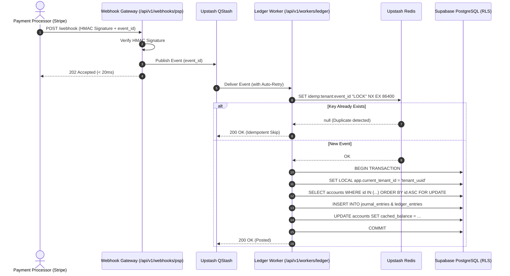

# System Design: Multi-Tenant FinTech Ledger & Reconciliation Engine

## 1. Executive Summary
Ovaj sistem predstavlja visoko-konzistentni, multi-tenant finansijski engine dizajniran za B2B marketplace platforme (poput Ubera, Wolta ili Stripe Connect-a). Sistem rešava problem praćenja toka novca u realnom vremenu kroz **dvojno knjigovodstvo (Double-Entry Accounting)**, automatsku raspodelu sredstava (**Split Payments**), idempotentnu obradu asinhronih webhook događaja i automatsko sravnjivanje sa eksternim bankovnim izvodima (**Reconciliation**).

---

## 2. Arhitekturni Ciljevi i Ograničenja (Design Goals)

| Cilj | Implementaciono Rešenje | Zašto je ovo kritično? |
| :--- | :--- | :--- |
| **Zero Data Loss & Exact Math** | `BIGINT` reprezentacija u centima + *Largest Remainder* algoritam | Eliminacija IEEE 754 floating-point grešaka pri zaokruživanju provizija. |
| **Strict Immutability** | PostgreSQL `BEFORE UPDATE OR DELETE` trigeri | Finansijska revizija (Audit) zahteva da se istorija nikada ne menja, već samo stornira. |
| **Database-Level Multi-Tenancy** | PostgreSQL Row-Level Security (RLS) sa `SET LOCAL` kontekstom | Sprečava curenje podataka između B2B klijenata čak i u slučaju greške u aplikativnom sloju. |
| **Idempotency Under Concurrency** | Redis `SET NX` distribuirani lock + DB kompozitni `UNIQUE` indeks | Garantuje *Exactly-Once* efekat knjiženja uprkos mrežnim retry-evima i duplim webhook-ovima. |
| **Serverless Connection Resilience** | Supabase Supavisor (Transaction Pooler) + Upstash QStash buffering | Sprečava iscrpljivanje DB konekcija prilikom naglih skokova (spike-ova) saobraćaja. |

---

## 3. Tok Podataka (Data Flow & Concurrency Control)

### 3.1. Sinhroni i Asinhroni Prijem Transakcija



### 3.2. Sprečavanje Deadlock-a i Race Condition-a
U finansijskim sistemima sa velikim brojem paralelnih transakcija, dva najčešća problema su *Lost Update* (prepisivanje balansa) i *Deadlock* (međusobno blokiranje transakcija).
* **Rešenje za Lost Update:** Sve promene stanja na računima izvršavaju se unutar ACID transakcije uz pesimističko zaključavanje (`FOR UPDATE`) ili atomične inkremente (`cached_balance = cached_balance + delta`).
* **Rešenje za Deadlock:** Pre zaključavanja redova u tabeli `accounts`, aplikativni sloj uvek sortira UUID-jeve pogođenih računa u rastućem redosledu (`ORDER BY id ASC`). Na taj način sve konkurentne transakcije stiču brave (*locks*) istim redosledom, čime je pojava *Deadlock*-a matematički eliminisana.

---

## 4. Model Podataka i Računovodstvena Logika

Sistem implementira standardni kontni okvir sa 4 osnovne klase računa:
1. **ASSET (`1000-ESCROW`):** Sredstva primljena od kupaca koja se nalaze na zbirnom računu platforme.
2. **LIABILITY (`2000-MERCHANT-PAYABLE`):** Obaveze platforme prema partnerima/prodavcima (novac koji pripada njima).
3. **REVENUE (`4000-PLATFORM-REVENUE`):** Prihod platforme od provizije.
4. **EXPENSE (`5000-PSP-FEES`):** Troškovi transakcionih provizija platnog procesora.

**Osnovna invarijanta sistema:**
$$\text{Assets} + \text{Expenses} = \text{Liabilities} + \text{Revenue}$$

Svaka transakcija prolazi kroz validaciju pre upisa u bazu koja garantuje da je $\sum \text{Debit} = \sum \text{Credit}$. Ukoliko ova jednačina nije zadovoljena, transakcija se odbija pre otvaranja konekcije ka bazi.

---

## 5. Reconciliation Engine (Sravnjivanje Izvoda)
Reconciliation servis radi po principu **Set-Based Outer Join poređenja** između internih zapisa (`journal_entries`) i eksternog izvoda banke/procesora:
* **`MATCHED`:** `external_ref_id` postoji na obe strane i iznosi u centima su identični.
* **`DISCREPANCY`:** ID postoji na obe strane, ali postoji razlika u iznosu (npr. procesor je naplatio dodatnu naknadu za međunarodnu karticu). Sistem automatski izračunava deltu (`psp_amount - ledger_amount`) i označava zapis za reviziju.
* **`MISSING_IN_LEDGER`:** Novac je legao kod procesora, ali webhook nikada nije stigao do našeg sistema.
* **`MISSING_IN_PSP`:** Transakcija je proknjižena u našem sistemu, ali još uvek nije proknjižena u bankovnom izvodu (*Settlement delay*).
---

## 6. Implementacione Napomene (As-Built)

| Oblast | Kako je implementirano |
| :--- | :--- |
| **Stack** | Next.js 16 (App Router, Cache Components / PPR), Drizzle ORM, `postgres-js`, Supabase PostgreSQL (eu-west-2, Supavisor transaction pooler :6543), Vercel |
| **Tenant kontekst** | `withTenant()` → `BEGIN` → `set_config('app.current_tenant_id', id, true)` → `SET LOCAL ROLE ledger_app` → upiti → `COMMIT` (ADR-005) |
| **Knjiženje** | `ledger.service.ts`: validacija u memoriji → `INSERT … ON CONFLICT DO NOTHING` (idempotency) → `SELECT … ORDER BY id FOR UPDATE` → ledger stavke → atomični `cached_balance = cached_balance + Δ`, `version + 1` |
| **Odbrana u dubinu** | `CONSTRAINT TRIGGER … DEFERRABLE INITIALLY DEFERRED` proverava Σ debit = Σ credit pri `COMMIT`; `CHECK (amount > 0)`; triger zabranjuje `UPDATE/DELETE` nad `ledger_entries` i brisanje `journal_entries` |
| **Webhook** | HMAC-SHA256 potpis (`t=…,v1=…`, tolerancija 5 min, `timingSafeEqual`) → QStash ili `after()` fallback → `202` (ADR-006) |
| **Reconciliation** | Neto iznos po `external_ref_id` (uplata − refundacija), čista funkcija `reconcile()` (outer join), snapshot se atomično zamenjuje |
| **Pooler** | `prepare: false`, `max_pipeline: 1` (ADR-007) |

### 6.1. Model Knjiženja Uplate (ADR-008)

```
Uplata 100,00 (split 82 / 15 / 3)
  DR 1000-ESCROW              97,00
  DR 5000-PSP-FEES             3,00
      CR 2000-MERCHANT-PAYABLE    82,00
      CR 4000-PLATFORM-REVENUE    18,00   (neto prihod platforme = 18 − 3 = 15)
```

## 7. Strategija Testiranja (Quality Gates)

| Nivo | Šta se proverava | Rezultat |
| :--- | :--- | :--- |
| **Unit** (Vitest, 59 testova) | Largest Remainder (uklj. 2 000 nasumičnih property slučajeva i iznose > 2^53), pravila dvojnog knjigovodstva, model uplate/storna, matcher, HMAC, BigInt novac, idempotency (fail-open) | 100% linija · 99,2% grana (prag 85%) |
| **Integration** (živa Supabase baza, sandbox tenanti) | 50 paralelnih uplata + 20 paralelnih duplikata (bez lost update-a), trka dve refundacije, RLS čitanje/pisanje između tenanata, triger nepromenljivosti, odloženi triger balansa | 5/5 |
| **Data audit** (`npm run db:preview`) | Jednačina po tenantu, RLS dokaz, Σ debit = Σ credit za svaki nalog, `cached_balance` == replay stavki, nema duplih ključeva, nema float kolona | 10/10 |
| **Chaos** (UI / `POST /api/v1/simulator`) | 25 konkurentnih uplata + isti webhook 10× | 25 proknjiženo, 1 webhook nalog, 9 duplikata blokirano, ledger u balansu |
